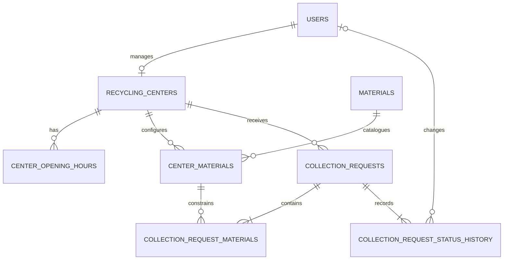

# Modelo de dados — Recicla Palhoça

**Sprint:** 2 — Modelagem do banco de dados  
**Banco alvo:** MySQL relacional  
**Status:** proposta técnica inicial para revisão antes da implementação da API

## 1. Objetivo e escopo

Este modelo persiste os centros de reciclagem, responsáveis autenticados, materiais aceitos, horários de atendimento e solicitações de coleta. Ele deriva dos requisitos RF-01 a RF-13 e das regras RB-01 a RB-07.

A primeira versão não cria contas de cidadão. A consulta pública usa dados publicados dos centros; o cidadão registra nome e telefone no pedido e consulta seu status pelo protocolo e telefone. Dados pessoais do pedido não devem ser disponibilizados na consulta pública.

## 2. Diagrama entidade-relacionamento

### Cardinalidades

- **USERS → RECYCLING_CENTERS (1:0..1):** no MVP, uma conta gerencia no máximo um centro; todo centro tem um responsável. Se a decisão futura permitir vários responsáveis por centro ou um responsável por vários centros, substituir esta relação por uma tabela associativa de permissões.
- **RECYCLING_CENTERS → CENTER_OPENING_HOURS (1:N):** um centro pode possuir vários períodos de atendimento por dia.
- **RECYCLING_CENTERS ↔ MATERIALS (N:N):** implementada por `center_materials`, que mantém o estado de aceitação atual de cada material.
- **RECYCLING_CENTERS → COLLECTION_REQUESTS (1:N):** cada solicitação pertence a um único centro.
- **COLLECTION_REQUESTS ↔ MATERIALS (N:N):** implementada por `collection_request_materials`; um pedido precisa ter ao menos um material.
- **COLLECTION_REQUESTS → COLLECTION_REQUEST_STATUS_HISTORY (1:N):** cada pedido tem um evento inicial `PENDENTE` e um evento por mudança de estado.
- **USERS → COLLECTION_REQUEST_STATUS_HISTORY (1:N, opcional por evento):** mudanças realizadas por responsável autenticado registram o usuário; o evento inicial, criado pelo sistema, não tem usuário executor.

## 3. Entidades e responsabilidades

| Tabela | Responsabilidade | Restrições relevantes |
|---|---|---|
| `users` | Credenciais e identidade do responsável pelo centro. | E-mail único; guardar apenas hash de senha, nunca senha em texto puro. |
| `recycling_centers` | Perfil público, endereço, coordenadas, contato e serviços. | Um responsável por centro no MVP; centro inativo não aparece em consulta pública. |
| `center_opening_hours` | Períodos de atendimento por dia da semana. | Chave por centro, dia e período; hora de abertura anterior ao fechamento. |
| `materials` | Catálogo controlado de materiais recicláveis. | Slug único; desativar categorias em vez de excluir materiais referenciados. |
| `center_materials` | Relação entre centros e materiais e se o centro atualmente aceita cada material. | Chave composta `(center_id, material_id)`; quando deixar de aceitar, marcar `is_accepted = false`, sem excluir a relação. |
| `collection_requests` | Dados do solicitante, endereço de coleta, preferências, protocolo e estado atual. | Protocolo UUID único; estado inicial `PENDENTE`; dados privados. |
| `collection_request_materials` | Materiais solicitados em cada pedido. | Um material não pode ser repetido no mesmo pedido; chaves estrangeiras vinculam o pedido ao centro e à relação de materiais desse centro. |
| `collection_request_status_history` | Histórico de estados e justificativas de recusa. | Um evento inicial por pedido; recusa exige justificativa na camada de serviço. |

## 4. Decisões de modelagem

### 4.1 Responsável e centro

A conta guarda nome, e-mail, hash da senha e status de acesso. O perfil do centro guarda o nome público do estabelecimento e o telefone público do centro. São dados distintos: o nome da conta não substitui o nome público do centro.

Para reduzir a complexidade do MVP, foi adotada uma relação de um responsável para, no máximo, um centro. A relação deverá ser revisitada antes da implementação caso o requisito passe a permitir vários responsáveis para o mesmo centro.

### 4.2 Endereço e coordenadas

O endereço do centro é dividido em logradouro, número, complemento, bairro, CEP, município e UF para facilitar exibição e filtragem. O CEP é armazenado sem máscara. Latitude e longitude usam `DECIMAL` para evitar que a persistência introduza ruído binário na coordenada.

As coordenadas aceitam valor nulo enquanto o perfil é preparado. A API só permite publicar/ativar um centro quando latitude e longitude estiverem preenchidas e todos os dados obrigatórios, incluindo horários, estiverem válidos. Centro ativo sem perfil completo não deve ser retornado na consulta pública.

### 4.3 Horários

A tabela `center_opening_hours` permite vários períodos de atendimento no mesmo dia, identificados por um número sequencial a partir de 1. O número do dia segue ISO: 1 = segunda-feira e 7 = domingo. Dia sem linhas representa ausência de atendimento naquele dia. A regra de publicação exige horários completos conforme validação da API.

### 4.4 Catálogo e materiais aceitos

`materials` é o catálogo disponível para seleção. `center_materials` registra a associação do material ao centro. Ao deixar de aceitar um material, o centro atualiza `is_accepted`; a associação não deve ser apagada, porque pedidos antigos podem referenciar aquele par.

Ao criar pedido, a API deve verificar dentro de uma transação que o centro está ativo, oferece coleta e aceita todos os materiais selecionados. A chave estrangeira composta em `collection_request_materials` protege a integridade entre pedido, centro e associação de material; a condição atual `is_accepted = true` continua sendo validada pela API.

### 4.5 Protocolo e estados

O protocolo é gerado pela aplicação com `crypto.randomUUID()` e armazenado com índice único. Não deve ser um ID incremental público. A API consulta usando o protocolo e o telefone normalizado, sem expor dados quando a combinação não confere.

Os estados persistidos são `PENDENTE`, `ACEITA`, `RECUSADA` e `CONCLUIDA`. A interface exibe `CONCLUÍDA` com acento. A API valida as transições; o banco garante os valores possíveis e o histórico registra quem executou a transição e a justificativa quando houver recusa. Ao criar um pedido, a aplicação grava o pedido, seus materiais e o evento inicial `PENDENTE` na mesma transação.

### 4.6 Exclusão e histórico

O MVP usa desativação lógica para usuários, centros e materiais. Não se deve excluir fisicamente um centro ou material que possua referências históricas. As chaves estrangeiras usam restrição de exclusão para evitar perda acidental de pedidos e eventos.

### 4.7 Privacidade

Nome, telefone e endereço de coleta são dados privados. A consulta pública de centros nunca deve retornar essas colunas. O serviço da API restringe os dados do pedido ao próprio solicitante, após validar protocolo + telefone, e ao responsável autenticado do centro destinatário. Logs comuns não devem registrar telefone, endereço, senha, token ou corpo completo do pedido.

## 5. Regras que ficam na API e não apenas no banco

O esquema relacional não substitui a validação de negócio. Antes de persistir uma operação, a API precisa garantir:

1. Centro publicado tem cadastro completo, coordenadas válidas, horário de atendimento e está ativo.
2. Apenas um responsável autenticado pode administrar seu centro e os pedidos dele.
3. Um pedido só é criado para um centro ativo que ofereça coleta e aceite todos os materiais indicados.
4. Todo pedido tem ao menos um material; a transação deve gravar pedido, materiais e histórico inicial de forma atômica.
5. `PENDENTE` pode mudar para `ACEITA` ou `RECUSADA`; recusa exige justificativa. Somente `ACEITA` pode mudar para `CONCLUIDA`.
6. O solicitante só consulta o pedido quando protocolo e telefone correspondem; a resposta de erro não revela se um protocolo existe.
7. Datas preferenciais não são confirmação de agendamento.
8. Coordenadas e CEP devem ser validados e normalizados no backend; latitude deve estar entre -90 e 90 e longitude entre -180 e 180.

## 6. Arquivo SQL

O DDL inicial está em [`backend/database/schema.sql`](../backend/database/schema.sql). Ele cria as tabelas, restrições, índices e relacionamentos apresentados no diagrama. O script não cria o banco de dados em si; deve ser executado em uma base previamente selecionada pela configuração local.

## 7. Checklist de validação do modelo

- [ ] Confirmar a relação de um responsável para, no máximo, um centro no MVP.
- [ ] Revisar entidades e cardinalidades com os requisitos aprovados.
- [ ] Executar o DDL no MySQL configurado no ambiente de desenvolvimento.
- [ ] Conferir criação de todas as chaves estrangeiras e índices.
- [ ] Testar integridade das associações centro-material e pedido-material.
- [ ] Testar preservação do histórico ao desativar centro/material.
- [ ] Registrar o resultado da validação na evidência da Sprint 2.

**Observação:** o diagrama e o script constituem a proposta inicial do modelo. A tarefa só deve ser marcada como concluída após a execução do DDL no ambiente MySQL e a verificação dos relacionamentos.
