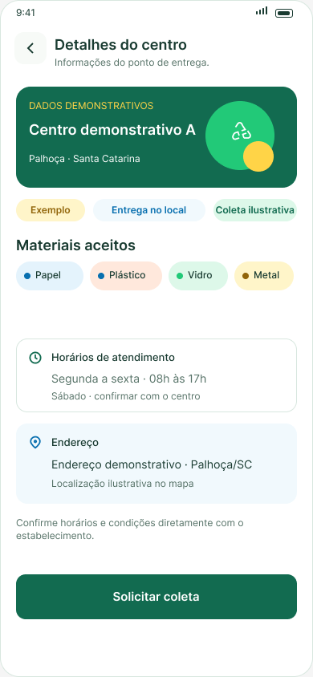
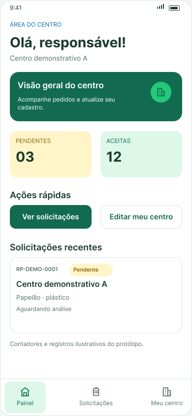

# Texto para incorporar ao relatório final — seção 5.1.1

## 5.1.1 Elaboração da Aplicação Mobile

### 5.1.1.1 Levantamento e especificação dos requisitos

Antes da implementação, foram detalhados os requisitos funcionais e não funcionais do Recicla Palhoça, transformando o escopo da Etapa 1 em comportamentos verificáveis. A especificação orienta a modelagem do banco de dados, a definição dos endpoints da API, a construção das telas mobile e os testes automatizados. Os requisitos foram identificados por códigos para manter a rastreabilidade entre necessidade, implementação e validação.

Foram definidos três elementos participantes: cidadão, responsável pelo centro de reciclagem e sistema/API. A API valida dados, aplica regras de acesso, calcula proximidade e controla estados das solicitações. A consulta pública não exige autenticação; a gestão do perfil do centro e dos pedidos recebidos exige acesso autenticado.

### 5.1.1.2 Requisitos funcionais

Os requisitos funcionais foram organizados em quatro grupos, totalizando 14 requisitos (RF-01 a RF-14).

| Grupo | Requisitos | Comportamento previsto |
|---|---|---|
| Consulta pública | RF-01 a RF-05 | Listar centros ativos, pesquisar/filtrar por nome, bairro, material e coleta; definir referência; ordenar por proximidade; consultar detalhes e serviços. |
| Gestão do centro | RF-06 a RF-08 | Criar conta, autenticar responsável, manter apenas o próprio perfil, materiais aceitos, horários e serviços. |
| Solicitações | RF-09 a RF-13 | Criar pedido para centro ativo que oferece coleta; gerar protocolo; consultar status por protocolo/telefone; gerir pedidos e estados com autorização. |
| Estados da interface | RF-14 | Apresentar carregamento, ausência de resultados e erros com mensagens claras e nova tentativa quando apropriado. |

A localização poderá ser definida pela posição atual do dispositivo, mediante permissão, ou por endereço/CEP informado. Quando existirem coordenadas válidas, a ordenação será feita pela distância em linha reta. A interface deverá indicar que essa medida é aproximada, sem apresentá-la como distância rodoviária ou tempo de deslocamento.

O recebimento de materiais no local será representado separadamente da oferta de coleta. Não será permitido criar uma solicitação de coleta para centro inativo ou que não ofereça esse serviço.

### 5.1.1.3 Regras de negócio das solicitações

A solicitação deverá conter centro de destino, nome e telefone do solicitante, endereço de coleta e ao menos um material. Data/período preferenciais e observações são opcionais; uma preferência não equivale a agendamento confirmado. Ao persistir o pedido, o sistema gerará protocolo único e iniciará o estado `PENDENTE`.

A máquina de estados prevista para o MVP é:

| Estado atual | Próximo estado permitido | Responsável |
|---|---|---|
| Criação do pedido | `PENDENTE` | Sistema |
| `PENDENTE` | `ACEITA` | Centro destinatário |
| `PENDENTE` | `RECUSADA` | Centro destinatário, com justificativa |
| `ACEITA` | `CONCLUÍDA` | Centro destinatário |
| `RECUSADA` | Nenhum | Estado final no MVP |
| `CONCLUÍDA` | Nenhum | Estado final no MVP |

As transições serão validadas na API, independentemente dos controles da interface. Cada centro poderá consultar e alterar somente o próprio perfil e os pedidos que lhe pertencem. A consulta pública não retornará dados pessoais dos solicitantes; para acompanhar um pedido, o cidadão informará protocolo e telefone da solicitação. Cancelamento pelo cidadão, reabertura, notificações push e integração municipal permanecem fora do MVP.

### 5.1.1.4 Requisitos não funcionais

Foram definidos nove requisitos não funcionais (RNF-01 a RNF-09), relacionados à adaptação da interface, validação, segurança, privacidade, tratamento de erros, reprodutibilidade, testes, documentação e integridade dos dados.

| ID | Requisito | Critério de verificação |
|---|---|---|
| RNF-01 | Interface adaptável | Verificar telas em 360 dp e viewport de 390 × 844, sem sobreposição ou corte essencial. |
| RNF-02 | Validação no servidor | Enviar entradas inválidas diretamente à API e verificar rejeição sem persistência. |
| RNF-03 | Autenticação/autorização | Testar acessos sem/ com credenciais inválidas e tentativas de acessar dados de outro centro; armazenar senha com hash. |
| RNF-04 | Proteção de dados pessoais | Confirmar que consultas públicas não expõem nome, telefone ou endereço privado do solicitante. |
| RNF-05 | Tratamento de erros | Verificar respostas consistentes sem exposição de stack traces ou segredos. |
| RNF-06 | Reprodutibilidade | Seguir o README para iniciar serviços e testes em ambiente compatível. |
| RNF-07 | Testabilidade | Executar testes por camada e medir a cobertura da lógica de negócio; meta planejada de 70%. |
| RNF-08 | Documentação de API | Conferir contrato OpenAPI/Swagger contra os endpoints implementados. |
| RNF-09 | Integridade | Testar unicidade, relacionamentos, transições válidas e preservação de histórico ao desativar centros. |

### 5.1.1.5 Critérios de aceitação e rastreabilidade

Foram especificados 14 casos prioritários de aceitação (CA-01 a CA-14), abrangendo consulta pública, filtros combinados, alternativa manual quando GPS é negado, ordenação por distâncias conhecidas, detalhes dos serviços, e-mail duplicado, autorização por centro, criação/rejeição de pedidos, consulta privada por protocolo/telefone, transições de estado, ausência de resultados e reprodução do ambiente.

Cada caso será convertido em teste unitário, HTTP ou mobile conforme a responsabilidade de cada camada. Os resultados, a cobertura observada e as falhas corrigidas deverão ser registrados durante a execução. Os critérios planejados não devem ser tratados como resultados de teste já obtidos.

A especificação completa, com os requisitos RF-01 a RF-14, RNF-01 a RNF-09, regras de negócio e casos de aceitação, está mantida em `docs/requisitos-e-criterios-aceitacao.md`. Esse artefato deve ser atualizado quando decisões do produto mudarem, mantendo a rastreabilidade entre requisitos, código, testes e relatório.

### 5.1.1.6 Modelagem e validação do banco de dados

O banco de dados foi modelado em MySQL para persistir os responsáveis, centros de reciclagem, horários de atendimento, materiais aceitos e solicitações de coleta, incluindo seus itens e histórico de status. O modelo é composto por oito tabelas, agrupadas no Quadro X.

**Quadro X – Entidades do banco de dados do ReciclaPalhoça.**

| Grupo | Entidades | Finalidade |
|---|---|---|
| Cadastro e atendimento | `users`, `recycling_centers`, `center_opening_hours` | Responsáveis, dados do centro e horários de funcionamento. |
| Catálogo de materiais | `materials`, `center_materials` | Catálogo controlado e materiais aceitos por cada centro. |
| Solicitações | `collection_requests`, `collection_request_materials`, `collection_request_status_history` | Pedidos de coleta, materiais solicitados e histórico de status. |

Fonte: elaborado pelo autor (2026).

As principais relações são: um responsável pode administrar no máximo um centro (1:0..1); cada centro pode ter vários períodos de atendimento (1:N); centros e materiais possuem relação N:N, resolvida pela tabela associativa `center_materials`; e cada solicitação pode possuir vários itens e eventos de histórico (1:N). A restrição de unicidade sobre o responsável garante que uma conta não seja associada a dois centros.

**Figura X – Modelo entidade-relacionamento do ReciclaPalhoça.**  
[Inserir a imagem exportada do diagrama, garantindo que entidades, relacionamentos e cardinalidades estejam legíveis.]  
Fonte: elaborado pelo autor (2026).

O ambiente de persistência foi configurado com Docker Compose, utilizando MySQL 8.4 no container `recicla-palhoca`, administrado pelo MySQL Workbench.

**Figura X – Container MySQL do ReciclaPalhoça em execução.**  
[Inserir captura do Docker mostrando o container `recicla-palhoca`, a imagem MySQL 8.4 e o estado em execução. Não exibir credenciais.]  
Fonte: elaborado pelo autor (2026).

A execução do esquema criou as oito tabelas. A inspeção do catálogo do MySQL confirmou nove chaves estrangeiras, nove restrições `CHECK`, oito chaves primárias, oito restrições `UNIQUE` e 27 índices distintos.

**Figura X – Estrutura do banco no MySQL Workbench.**  
[Inserir captura com o schema `recicla_palhoca`, as oito tabelas na árvore lateral e o resultado da consulta que confirma a quantidade de tabelas.]  
Fonte: elaborado pelo autor (2026).

**Figura X – Restrições e índices do banco de dados.**  
[Inserir as capturas dos resultados de metadados do Workbench, organizadas como (a) restrições e (b) índices.]  
Fonte: elaborado pelo autor (2026).

Após a criação do esquema, foi preparado o catálogo inicial de materiais em `backend/database/seed.sql`, separado do DDL. O catálogo contém 12 categorias de referência: papel, papelão, plásticos, vidro, metais, embalagens longa vida, óleo de cozinha usado, pilhas e baterias, resíduos eletroeletrônicos, lâmpadas, pneus e roupas/tecidos. A presença de uma categoria no catálogo não significa que um centro específico aceite o material; essa associação será mantida individualmente em `center_materials`.

O Docker Compose foi atualizado para montar o seed após o esquema, na ordem `01-schema.sql` e `02-seed.sql`. Como o volume MySQL já estava inicializado, o seed foi aplicado manualmente no ambiente existente, sem apagar ou recriar o volume. A execução retornou os 12 materiais ativos; uma segunda execução apresentou a mesma lista, sem duplicações. A validação de configuração com `docker compose ... config --quiet` terminou sem erros.

**Figura X – Aplicação e validação do catálogo inicial de materiais.**  
[Inserir captura do terminal ou do MySQL Workbench exibindo a consulta dos 12 materiais ativos. Não exibir senhas ou outras credenciais.]  
Fonte: elaborado pelo autor (2026).

### 5.1.1.7 Configuração inicial do backend

Foi criada a estrutura inicial da API utilizando Node.js, Express e TypeScript, com conexão ao MySQL por meio de um pool de conexões. Foram implementados os endpoints `GET /health/live`, para verificar a disponibilidade do serviço, e `GET /health`, que consulta o banco e informa o estado da conexão. O ambiente foi integrado ao Docker Compose, mantendo a API e o MySQL em containers separados.

A validação inicial da estrutura do backend foi concluída: as dependências foram instaladas, a verificação de tipos e a compilação terminaram sem erros, os testes automatizados passaram e os endpoints de saúde responderam conforme esperado, incluindo a confirmação de conexão da API com o MySQL.

**Figura 5 – Execução dos serviços ReciclaPalhoça em Docker.**  
[Manter a captura existente dos containers `recicla-palhoca` e `recicla-palhoca-api` em execução.]  
Fonte: elaborado pelo autor (2026).

**Figura 6 – Verificação da API e da conexão com o MySQL.**  
[Manter a captura existente das respostas de `GET /health/live` e `GET /health`, incluindo `"database": "connected"` na segunda resposta.]  
Fonte: elaborado pelo autor (2026).

Na etapa seguinte, foi implementada a primeira versão da API de centros de reciclagem, com consulta, filtros, detalhes, cadastro, atualização e desativação lógica. A validação local confirmou TypeScript e build sem erros, 14 testes automatizados aprovados e respostas HTTP esperadas para consulta, filtro inválido e centro inexistente. Um teste adicional aprovou a criação, consulta, atualização e desativação diretamente no MySQL real, com limpeza dos dados temporários. Também foi implementada a autenticação inicial do responsável, com hash de senha, login e token Bearer para proteger as rotas de escrita. A validação local do TypeScript e da compilação terminou sem erros, e os testes automatizados aprovaram 22 testes. No ambiente Docker, o cadastro retornou HTTP 201, o login e a consulta da identidade autenticada retornaram HTTP 200, a rota protegida sem token retornou HTTP 401 e a chamada com token válido e corpo inválido retornou HTTP 400, conforme esperado.

Também foi disponibilizado o endpoint público `GET /materials`, que consulta o catálogo controlado pelo sistema e retorna os materiais ativos com identificador, nome, slug e descrição, em ordem alfabética. A associação dos materiais aceitos pelos centros é realizada pelos campos `materialIds` nos endpoints de cadastro e atualização, com validação dos materiais ativos e preservação dos vínculos anteriores em `center_materials`, marcados como não aceitos quando a seleção é substituída.

Para padronizar a descrição e o consumo dos serviços, foi elaborada a especificação da API no formato OpenAPI 3.1.0 e disponibilizada diretamente pelo backend por meio da interface Swagger UI, acessível na rota `/docs`. A especificação reúne os endpoints de disponibilidade, autenticação, consulta de materiais e gestão de centros, descrevendo parâmetros, estruturas de requisição e resposta, códigos de erro e o mecanismo de autenticação Bearer JWT.

### 5.1.1.8 Configuração e implementação inicial do aplicativo mobile

O aplicativo foi desenvolvido em React Native com Expo SDK 58, TypeScript e Expo Router. A validação da configuração foi realizada no navegador, sem depender de um dispositivo Android. O ambiente utiliza uma estrutura de navegação com as abas **Início** e **Centros** e telas empilhadas para a definição da localização de referência.

A tela inicial permite iniciar uma busca por centro ou bairro, acessar a definição de localização e consultar o catálogo de materiais. A tela de centros oferece pesquisa textual, filtros por material e disponibilidade de coleta e apresentação dos resultados retornados pela API. A aplicação consome os endpoints públicos `GET /materials` e `GET /centers`; não utiliza estabelecimentos fictícios como dados reais. Quando não há centros ativos e publicáveis cadastrados, apresenta um estado vazio com orientação para ajustar os filtros.

A localização de referência pode ser definida por GPS, mediante permissão, ou por CEP informado manualmente. No primeiro caso, o aplicativo obtém latitude e longitude e realiza geocodificação reversa pelo serviço Photon, que utiliza dados do OpenStreetMap, para identificar os elementos de endereço disponíveis. No segundo, consulta a BrasilAPI CEP v2, que retorna logradouro, bairro, município, UF, CEP e, quando disponíveis, coordenadas geográficas. Os dados da referência são compartilhados entre as rotas e apresentados no cartão da tela de centros. Informações não fornecidas pelas fontes não são presumidas. Quando existem coordenadas válidas, os centros são ordenados pela distância geográfica em linha reta, calculada pela fórmula de Haversine; essa medida não representa trajeto por ruas nem tempo de deslocamento.

Na evolução da tela Centros, foi incorporada a alternância entre as visualizações **Lista** e **Mapa**, mantendo a lista como modo padrão. A busca, os filtros, a consulta à API e a localização de referência são compartilhados pelas duas visualizações. A camada Web utiliza MapLibre GL JS, com o estilo cartográfico Liberty disponibilizado pelo OpenFreeMap; para as plataformas nativas foi configurado o MapLibre React Native. O mapa apresenta um marcador próprio para a localização de referência e marcadores dos centros somente quando a API fornece coordenadas geográficas válidas. Centros sem coordenadas continuam disponíveis na lista, sem receber marcadores. A seleção de um marcador de centro direciona para a tela de detalhes correspondente. A interface contempla estados de carregamento, ausência de resultados e falhas na consulta ou na obtenção do estilo cartográfico. Os créditos cartográficos podem ser consultados pelo controle de atribuição, sem permanecer expandidos sobre a área do mapa.

A integração entre o Expo Web e a API foi viabilizada por uma configuração CORS restrita às origens permitidas em `APP_WEB_ORIGINS`. A verificação no navegador confirmou a autorização da origem local `http://localhost:8081`; a requisição preflight `OPTIONS` respondeu HTTP 204, com os métodos e cabeçalhos necessários. Os containers da API e do MySQL permaneceram saudáveis, e a rota de saúde confirmou a conexão com o banco.

**Validação local concluída em 31/10/2026:** `npx expo lint` e `npx tsc --noEmit` terminaram sem mensagens de erro ou avisos. A execução de `npm test -- --runInBand` aprovou 16 testes em quatro suítes. No navegador, foram verificados o carregamento da tela inicial, a navegação entre as abas Início e Centros, a consulta que resultou no estado vazio esperado e a definição da localização pelos caminhos de GPS e CEP. O cartão de referência apresentou logradouro, bairro, município/UF e CEP conforme os dados retornados pelas fontes.

A interface apresentada nesta subseção corresponde ao primeiro incremento funcional do aplicativo, concentrado na consulta pública de centros e na definição da localização de referência. O protótipo de média fidelidade elaborado na Sprint 1 serviu como apoio à organização dos fluxos e à hierarquia inicial das informações, mas não foi adotado como especificação visual final. Para consolidar a experiência, foi criado um novo arquivo no Figma, preservando-se o arquivo original de média fidelidade sem alterações. O novo arquivo reúne os fundamentos visuais, a biblioteca de componentes e os fluxos completos de alta fidelidade. A definição visual e a prototipação foram concluídas antes da implementação correspondente no Expo; portanto, as telas e interações descritas a seguir representam a especificação visual e navegacional da solução, não a afirmação de que todas as respectivas funcionalidades já estejam implementadas no aplicativo.

**Figura X – Tela inicial e navegação do aplicativo ReciclaPalhoça no navegador.**  
[Inserir captura da tela inicial com a identidade do projeto e as abas Início e Centros.]  
Fonte: elaborado pelo autor (2026).

**Figura X – Consulta de centros e estado vazio da API.**  
[Inserir captura da tela Centros mostrando os filtros e a mensagem de ausência de centros públicos disponíveis.]  
Fonte: elaborado pelo autor (2026).

**Figura X – Definição da localização de referência.**  
[Inserir captura do cartão de referência com logradouro, bairro, município/UF e CEP. Utilizar dados de teste que não exponham endereço residencial pessoal.]  
Fonte: elaborado pelo autor (2026).

**Figura X – Visualização cartográfica de centros e localização de referência.**  
[Inserir captura da visualização Mapa na tela Centros, com o marcador da localização de referência e o controle de atribuição recolhido. Não apresentar a ausência de centros reais como erro da aplicação.]  
Fonte: elaborado pelo autor (2026).

> **Nota editorial:** substituir “Quadro X” e “Figura X” pelas numerações definitivas quando o conteúdo for incorporado ao relatório; atualizar o sumário automático, a lista de quadros e a lista de figuras, se houver.

### 5.1.1.9 Consolidação do design system e protótipo de alta fidelidade

A identidade visual do ReciclaPalhoça foi consolidada no Figma, adotando o verde como cor principal, com azul, coral e amarelo como cores complementares. A tipografia definida foi Inter, e a marca passou a combinar um pin de localização com o símbolo universal de reciclagem. Também foram estabelecidos tokens de cores, espaçamentos, raios, contornos e iconografia para orientar a consistência das interfaces.

A biblioteca de componentes reúne elementos reutilizáveis e suas variantes, incluindo botões, campos, filtros, indicadores de status, cartões e componentes de navegação. A auditoria do arquivo identificou 101 componentes, 14 conjuntos de variantes, 105 variáveis de design e nove estilos tipográficos. Esses recursos foram organizados para permitir a aplicação uniforme da identidade visual nas diferentes telas.

Com base nesse sistema, foi desenvolvido um protótipo de alta fidelidade com 16 telas mobile, em artboards de 390 × 844 pixels, distribuídas em dois percursos: cidadão (consulta de centros, localização e solicitação/acompanhamento de coleta) e responsável pelo centro (acesso, cadastro, gestão do estabelecimento e atendimento de solicitações). A navegação possui 75 interações registradas, e a auditoria estrutural confirmou destinos válidos para os 16 artboards. Os dados exibidos no protótipo são demonstrativos.

A revisão de qualidade corrigiu problemas de alinhamento, dimensões, espaçamento, filtros, cartões de solicitação e ícones de navegação. A marca foi refinada para integrar o símbolo de reciclagem ao pin, e informações técnicas desnecessárias foram removidas da tela de localização. O arquivo Figma passou a ser a referência visual para orientar a aplicação do design system às telas do aplicativo Expo. As capturas a seguir apresentam individualmente as principais interfaces dos dois percursos.

**Figura X – Tela inicial do ReciclaPalhoça.**

Fonte: elaborado pelo autor (2026), a partir do protótipo no Figma.

**Figura X – Consulta de centros próximos.**

Fonte: elaborado pelo autor (2026), a partir do protótipo no Figma.

**Figura X – Detalhes de um centro de reciclagem.**

Fonte: elaborado pelo autor (2026), a partir do protótipo no Figma.

**Figura X – Solicitação de coleta pelo cidadão.**

Fonte: elaborado pelo autor (2026), a partir do protótipo no Figma.

**Figura X – Painel do responsável pelo centro.**

Fonte: elaborado pelo autor (2026), a partir do protótipo no Figma.

**Figura X – Detalhe de solicitação recebida pelo centro.**

Fonte: elaborado pelo autor (2026), a partir do protótipo no Figma.

**Aplicação do design system no Expo.** O sistema visual foi aplicado às quatro telas existentes — Início, Centros, Definir localização e Detalhes do centro — com os tokens, a tipografia Inter, a marca e os componentes compartilhados. As integrações e os comportamentos funcionais foram preservados. A implementação foi conferida no Expo Web, e as verificações de TypeScript, lint e testes automatizados foram concluídas sem erros. Essa entrega abrange as quatro telas existentes, não as 16 telas do protótipo.

> **Nota editorial:** substituir “Quadro X” e “Figura X” pelas numerações definitivas quando o conteúdo for incorporado ao relatório; atualizar o sumário automático, a lista de quadros e a lista de figuras, se houver.
